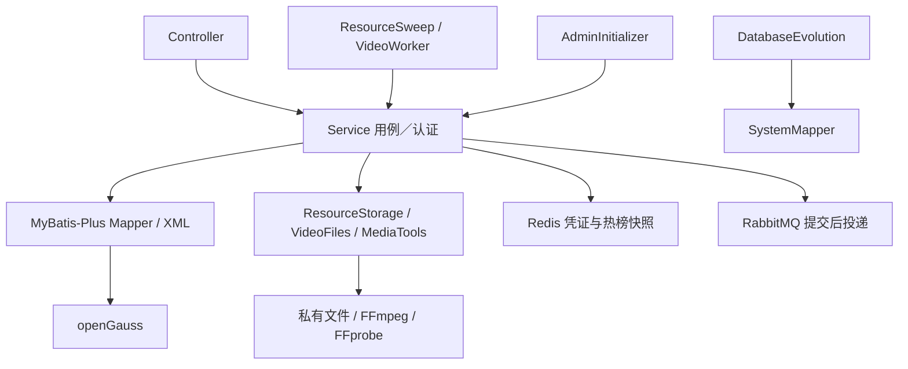

# 后端交付前审查 01：架构与依赖边界

审查日期：2026-11-10（Asia/Shanghai）。范围：当前工作区全部生产代码。交付：仅本报告；未修复代码、修改测试、提交 Git 或启动下一轮。

## 1. 结论与证据效力

- 主要分层成立：Controller／Job 调用 Service，关系数据库访问集中在 Mapper；未发现 Controller 直连 Mapper、应用直接 JDBC／JdbcTemplate、Service 反向依赖 Controller 或 Service 注入循环。
- 发现 **2 项已确认缺陷、1 项待验证风险、1 项可读性建议**。已确认指源码及所用依赖的控制流足以确定条件成立后的错误结果，不表示本轮已经运行故障或并发复现。
- 本轮未发现 P0。P1 为重要正确性问题；P2 为一般问题或建议。风险的优先级表示验证顺序，不表示已经发生故障。
- 历史 `contract-acceptance.md` 记录的 74 项通过及独立 JAR／重启结果仅为背景。本轮未运行 Maven、HTTP 回归或整体验收，未将历史绿灯计作本轮验证。
- 按 DEC-049，本报告不能给出新的整体验收通过结论；新发现须在后续处理和验证。历史验收记录原文保留，其结论不覆盖本轮新发现。
- 未发现需要裁决的 Spec／契约／决策相互冲突，未作技术选型。已确认业务规则、DEC-049、需求 10.4 及技术栈均未修改。

## 2. 审查基线和范围

### 2.1 Git 与工作区

| 项目 | 审查基线 |
| --- | --- |
| 工作目录 | `C:\Users\intelligent uesr\OneDrive\桌面\campus-forum` |
| HEAD | `27ed5bc0ec25b3ad3d216fd37022b8f04f18ad00`；Initial commit；2026-10-23 |
| HEAD 文件 | 仅 `LICENSE`、`README.md`，没有已提交的生产代码 |
| 已修改 | `README.md`；没有暂存修改 |
| 未跟踪 | `.gitignore`、`.mvn/settings.xml`、`compose.yaml`、`pom.xml`、`scripts/`、`docs/`、`src/`；全部生产代码均在其中 |
| 生产范围 | `src/main` 全部 75 个文件：64 个 Java、7 个 Mapper XML、application.properties、schema.sql、V002 迁移、默认头像 |
| 辅助范围 | pom.xml、Compose、README；全部 9 份测试源码用于检查已有验证意图，重点追踪架构、原子性、并发及媒体用例 |
| 本轮基线快照 | 对 Git 跟踪及未忽略的未跟踪文件共 107 个计算 SHA-256；报告新增前未修改文件 |

执行了 `git rev-parse HEAD`、`git log -1 --format=fuller`、`git ls-tree -r --name-only HEAD`、`git status --porcelain=v1 --untracked-files=all`、`git diff --stat`、`git diff --cached --stat`。同时以 `rg --files` 枚举并逐文件读取生产源码，审查不局限于 diff。沿工作目录祖先查找，未发现适用的 AGENTS.md。

为便于识别工作区版本，生产树摘要为：

```text
src/main（75）：e9bdbf0971eeb4d7bbc06fec68c9d4bc3eef2ff127a8d48c42995a6d6ff7bff2
src/test（9）：ce92ac6a73fc90217dc0c56b0238da460c345033fea6a38feedaa0d4ec8e01be
```

算法：按路径排序，对每个文件生成 `仓库相对路径（/分隔） + NUL + 文件内容SHA-256十六进制 + 换行`，将全部条目拼接后以 UTF-8 再计算 SHA-256。摘要标识本轮读取的文件，不代表功能验收结果。

### 2.2 已读取的规范和记录

| 文件 | 本轮用途 |
| --- | --- |
| [requirements.md](../requirements.md) | BR-01—46、AC-01—15、9.1 架构约束、10.4 刚性门槛 |
| [architecture-spec.md](../architecture-spec.md) | 包职责、允许依赖、Mapper 返回类型、事务及启动不变量 |
| [decision-log.md](../decision-log.md) | DEC-049、051—061，以及现有 IMPL 决定；区分历史 JDBC 选择和 DEC-055 覆盖后的现行约束 |
| [api-contract.md](../api-contract.md) | v1.0 落地基线；身份、响应字段、原子提交、回复删除、资源状态、异步任务边界 |
| [api-gap-analysis.md](../api-gap-analysis.md) | 既有差异关闭记录；历史描述不替代当前实现读取 |
| [implementation-plan.md](../implementation-plan.md) | 当前实施范围和批次状态；不因旧授权自动进入修复 |
| [contract-acceptance.md](../contract-acceptance.md) | 最新验收记录；仅作历史背景 |
| [backend-design.md](../backend-design.md)、[open-questions.md](../open-questions.md) | 现有事务、任务恢复、文件边界和已答问题 |
| [README.md](../../README.md)、[pom.xml](../../pom.xml)、[compose.yaml](../../compose.yaml) | 本地运行边界、实际依赖及部署约定 |

关键基线文件 SHA-256：

```text
requirements.md       e5361502b54f56e64f97ade5bbc02e467a60b20711a20e14fdc28d8f4d8d43a9
architecture-spec.md  3bb14c3c503fb6ead4485da851988a3384f3f59801064c02d770e14d31add197
decision-log.md       55e4087e90568664fd50556c16ebde34f67ef1fb1b27a880c10cbabecf6e992c
api-contract.md       c37fdff4bce297d49ada0cab858b0e680112322864fe42885d651b5985ae45cc
implementation-plan.md a4694c234482f81280bd379d1c650039af4e03b651a0159b9bb9a25997f9c82f
contract-acceptance.md ad94602bc6f90c8d96397874126f57352699ba303b22686716b58cff79491554
```

### 2.3 生产代码读取清单

以下类型均逐文件读取，非仅按包名推断职责。路径前缀为 `src/main/java/campus/`。

| 包 | 已读取类型 |
| --- | --- |
| 根入口（1） | ForumApplication |
| controller（9） | AuthController、UsersController、PostController、InteractionsController、CommentsController、HotFeedController、MediaController、ResourceMaintenanceController、DependenciesController |
| service（10） | AccountService、SessionService、UserService、PostService、InteractionService、CommentService、HotFeedService、MediaService、VideoService、DependencyService |
| mapper（7） | UserMapper、PostMapper、CommentMapper、InteractionMapper、ResourceMapper、ChunkMapper、SystemMapper；同时读取对应全部 XML |
| entity（7） | UserEntity、PostEntity、PostView、CommentEntity、InteractionEntity、ResourceEntity、ChunkEntity |
| dto（15） | RegisterRequest、LoginRequest、ProfileRequest、UserBatchRequest、SubmissionRequest、EditPostRequest、ReviewRequest、CommentRequest、VideoStartRequest、CurrentUser、PublicUser、PostCard、HotSnapshot、MediaFile、VideoPart |
| config（6） | RuntimeConfig、DatabaseEvolution、AdminInitializer、VideoConfiguration、JacksonContractConfiguration、QueryContractConfiguration |
| job（2） | ResourceSweep、VideoWorker |
| infrastructure（3） | ResourceStorage、VideoFiles、MediaTools |
| exception／support（4） | BusinessException、ApiExceptionHandler、TextValidation、AvatarUrls |

## 3. 架构及依赖关系



- Controller 处理绑定、状态码、认证入口及响应。MediaController 的 Range 校验与文件响应、InteractionsController 的 HTTP 动词／路径适配均属于 HTTP 职责；没有在 Controller 内执行投稿、审核或持久化流程。
- Service 负责用例及对象权限。接口角色判断通过 SessionService 调用；传入 CurrentUser 是已认证内部上下文，并非客户端可提交的角色字段。
- Service 构造器依赖图：Session→Account；User→Account、Media；Post→Media；Interaction→Post；Comment→Post、User；HotFeed→Post；Video→Media。Account、Media、Dependency 无 Service 下游。逐项追踪且脚本遍历未发现环；未发现 `@Lazy` 或服务定位器绕开循环检查。
- MediaService 使用 PostMapper 判断资源所属帖可见性，而不反向注入 PostService；该调用符合 Service→Mapper，不能仅因访问多个业务表判为越层。
- User／Post／Comment／Resource 四个 Mapper 继承 BaseMapper。Interaction／Chunk 保留联合主键及具名 XML；SystemMapper 仅提供版本探测、列检查和固定 DDL，不提供任意 SQL 入口。
- Entity 表达持久化；PostView 是查询投影。CurrentUser、PublicUser、PostCard 等用于认证／输出，VideoPart／MediaFile 是技术边界数据。其余响应以白名单 Map 组合，符合现有分层规范，不要求为每个 Map 新建类型。
- Redis、RabbitMQ 与文件适配是现有 Service 的技术协作，没有新增通用 Repository、空接口或框架的必要。

## 4. 发现清单

| ID | 类别 | 优先级 | 发现 |
| --- | --- | --- | --- |
| ARCH-01 | 已确认缺陷（静态） | P1 | 回复创建可能命中锁前 MyBatis 一级缓存，漏过并发删除校验 |
| ARCH-02 | 已确认缺陷（静态） | P2 | 图片插入已提交后，查询失败的补偿仅删除文件，留下 READY 元数据 |
| ARCH-03 | 待验证风险 | P2 | 媒体进程等待被中断时没有终止已启动子进程 |
| ARCH-04 | 可读性建议 | P2 | 多条资源写入方法的外层事务前置条件没有在方法处说明 |

### ARCH-01｜P1｜已确认缺陷：锁前缓存使回复删除校验失效

**2026-11-10 整改状态：已修复并通过本轮定向及完整回归。** 两种确定性并发时序均先在真实 HTTP／openGauss 中复现 HTTP 201 和漏删回复，再修复为 404；76 项 full-media 回归通过。方法、边界及证据见 [02-arch01-verification.md](02-arch01-verification.md)。以下原始发现及当时的验证边界保留为历史记录。

- **位置**：[CommentService.java](../../src/main/java/campus/service/CommentService.java) 第 41—44、71—86 行；[PostMapper.xml](../../src/main/resources/mapper/PostMapper.xml) 第 13—17 行；[CommentMapper.xml](../../src/main/resources/mapper/CommentMapper.xml) 第 40—49 行；[application.properties](../../src/main/resources/application.properties) 第 26—29 行。
- **证据**：create 是事务入口。第 74 行先 `row(target)` 取所属帖子，第 75 行才获取帖子锁，第 80 行再次 `row(target)` 检查 deletedAt。两次 row 使用同一个 `CommentMapper.selectById`、同一个 ID；两次之间没有本事务的更新或显式清缓存。lockActive 的 SELECT 没有配置 flushCache。
- **依赖证据**：现有产物包含 MyBatis 3.5.19、MyBatis-Spring 3.0.6、MyBatis-Plus 3.5.18。读取本机对应 MyBatis 源码包：Configuration.java 第 125 行默认 LocalCacheScope.SESSION；BaseExecutor.java 第 148—158 行可直接返回本会话缓存，第 169—171 行仅 STATEMENT 范围自动清理；XMLStatementBuilder.java 第 68—70 行 SELECT 默认不刷新缓存。项目没有覆盖 local-cache-scope。MyBatis-Plus 的选择器仍使用该执行器缓存机制。
- **触发时序**：删除事务先持有帖子锁但尚未提交；回复事务先读到目标未删版本并等待帖子锁；删除事务标记目标（或根及其全部回复）已删并提交；回复事务取得帖子锁，第二次 selectById 返回本事务锁前缓存的未删目标；随后插入新回复。
- **实际影响**：已删目标仍可能收到成功的新回复，违反 BR-21、契约 C02。若根被删，新回复未被已结束的级联覆盖，保留 deletedAt=null；其自身详情与本人历史也可能表现为未删，破坏根删除结果。数据库外键只保证目标行存在，不能阻止逻辑删除后的引用。
- **建议方向**：保留帖子锁裁决；锁前仅取得定位信息，锁后校验必须真实读取当前目标状态。通过具名 Mapper 读取及针对性的缓存处理实现，不仅重复调用同一 selectById；不要只设置 useCache=false 就认为消除了一级缓存。后续用确定性屏障覆盖“删回复／删根已持锁，创建已完成锁前读取”的时序。
- **验证边界**：源码、配置及实际版本依赖机制已核对；本轮没有运行并发复现。现有 RemainingFlowsTest 和 ContractCoverageTest 的删除后再回复是顺序请求，不能排除此时序。

### ARCH-02｜P2｜已确认缺陷：图片异常补偿跨越已提交的数据库写入

**2026-11-10 整改状态：已修复并通过本批 87 项完整回归。** 真实数据库及文件故障验证、提交不确定性、过期回收和清理竞争详见 [03-arch02-verification.md](03-arch02-verification.md)。以下原始发现及当时验证边界作为历史记录保留。

- **位置**：[MediaService.java](../../src/main/java/campus/service/MediaService.java) 第 63—79、120—130、209—220 行；[ResourceStorage.java](../../src/main/java/campus/infrastructure/ResourceStorage.java) 第 35—40、49—58 行；[MediaController.java](../../src/main/java/campus/controller/MediaController.java) 第 68—74 行。
- **证据**：image 没有事务，Controller 直接调用；insertImage 的资源 INSERT 在返回前已经提交，随后第 72 行 info 又查询数据库。整个区间的 RuntimeException 均由第 76—78 行捕获，补偿仅 removeDirectory，没有回滚或更改元数据状态。
- **依赖证据**：核对本机 MyBatis-Spring 3.0.6 的 SqlSessionTemplate$SqlSessionInterceptor 字节码：非 Spring 事务的 Mapper 调用完成后执行 commit(true)，随后关闭会话。不能把后续 info 失败理解为此前 INSERT 自动回滚。
- **触发条件**：文件写入及格式检查成功，资源 INSERT 已成功提交；紧随其后的 info 查询因数据库暂时故障等抛出 RuntimeException；文件删除成功。
- **实际影响**：HTTP 返回失败，数据库留下 state=READY 的记录，而 original 已删除。若后续持该 ID 访问或关联，元数据／绑定校验可接受，文件读取却 404；无客户端拿到 ID 时仍留下不一致元数据，直至到期回收。这里不是声称普通成功上传必然丢文件，也不把未知提交结果当成确定失败。
- **建议方向**：明确数据库提交与文件补偿的顺序；失败后不得保留指向已删文件的 READY 记录。可在现有 Spring 事务及补偿机制内处理，并覆盖提交本身失败的情况；单纯给 image 加注解而忽略事务代理在方法返回后的提交异常，仍不足以解决全部边界。无需引入分布式事务或新存储技术。
- **验证边界**：已确认可达的条件故障路径；本轮没有注入“插入成功、随后读取失败”的真实数据库故障。现有投稿绑定原子性测试验证的是上传之后的帖子事务，不能证明此上传路径的补偿正确。

### ARCH-03｜P2｜待验证风险：线程中断后的媒体子进程生命周期

**2026-11-11 整改状态：真实进程测试复现后已修复，定向及媒体回归通过。** 详见 [04-arch03-verification.md](04-arch03-verification.md)；以下原始风险记录保留。

- **位置**：[MediaTools.java](../../src/main/java/campus/infrastructure/MediaTools.java) 第 61—75、175—184 行；[VideoService.java](../../src/main/java/campus/service/VideoService.java) 第 166—179 行。
- **证据**：正常超时分支会 destroyForcibly；waitFor 抛 InterruptedException 时没有 finally 终止 process。probe 只恢复中断标记并抛业务异常；hls 将中断上抛，VideoService 将资源记 FAILED，并恢复线程中断状态。
- **触发条件**：FFprobe／FFmpeg 已启动，等待线程在执行期间被中断，且宿主没有同时终止子进程。具体关闭／中断路径是否会在当前运行方式发生，尚未复现。
- **可能影响**：父任务已失败或正在退出，子进程仍占用 CPU／文件句柄并继续写入工作目录；任务状态与执行状态不一致。不能据此声称已经发生文件泄漏、并发覆盖或期限清理失败。
- **建议方向**：由现有基础设施适配器负责中断、超时和异常退出时的子进程终止与回收，保留中断语义；用真实进程中断验证退出和目录状态。无需增加业务层抽象。
- **尚需证据**：正在转码时中断等待线程，观察子进程是否退出、状态是否稳定、是否仍写文件。本轮未执行，暂不升级为已复现故障。

### ARCH-04｜P2｜可读性建议：说明资源写入辅助方法的事务前置条件

**2026-11-11 处理状态：已在辅助方法处说明调用者事务和锁顺序。** 未新增接口或抽象层；下方保留原审查记录。

- **位置**：[MediaService.java](../../src/main/java/campus/service/MediaService.java) 第 144—172、178—198 行；[PostService.java](../../src/main/java/campus/service/PostService.java) 第 83—92、176—200 行；[UserService.java](../../src/main/java/campus/service/UserService.java) 第 32—41 行。
- **证据**：bindPost、retirePost、bindAvatar 自身不声明事务，当前调用点分别处于 PostService／UserService 的事务内，所以现有调用链能够共享事务。方法处未明确必须具有外层事务、先锁定帖子／用户等前提。
- **触发条件及影响**：当前调用没有因缺注解而被认定为事务失效。维护者未来从另一个非事务用例直接复用这些 public 方法时，可能误以为它们是独立原子入口；这是理解成本及误用风险，不是当前已确认功能缺陷。
- **建议方向**：在方法附近写明“内部编排辅助、必须由指定用例事务调用”及锁顺序，并保留对调用点的检查。不要求新增接口、Repository 或仅为转发存在的 Service。

## 5. 已检查但未发现问题的部分

以下是本轮源码检查结果；均不宣称等同于动态验收通过。

| 检查项 | 当前证据与结论 |
| --- | --- |
| Controller 职责 | 全部 9 个 Controller 未导入 Mapper／Entity，未声明事务；只调用 Service 及 DTO／HTTP 类型。角色判断调用 SessionService；Range／multipart／HTTP 方法解析属于适配职责 |
| Service 依赖方向 | 全部 10 个 Service 无 Controller 导入；构造器图无环，无自行 new Service、自取代理或循环依赖开关；Service 没有调度或 MQ 注解 |
| 数据访问归属 | 7 个 Mapper 对应 7 个 XML，共 49 条具名语句；4 个单主键 BaseMapper 符合规范。全部 Java 未发现直接 JDBC、JdbcTemplate、RowMapper、手工 SqlSession 或 Java 内 SQL。XML 无 `${...}` 任意文本替换；参数绑定及排序 choose 为固定结构 |
| JDBC 依赖边界 | pom 中 openGauss JDBC 驱动和传递 Spring JDBC 是 ORM 底层依赖；应用未直接调用它们。jdbc:postgresql URL／org.postgresql.Driver 是既有 openGauss 驱动的协议入口，不据此判为擅换数据库 |
| Entity／DTO／投影 | Entity 无业务服务、HTTP 或外部调用；PostView 扩展持久化字段用于查询但未直接返回给 Controller。BaseMapper 结果在 Service 内转换，未以数据库 Map 穿透业务层 |
| 敏感字段 | UserEntity.passwordHash 只用于密码比对；AccountService 第 72—77 行、UserService 第 44—53 行、PostService 第 47—68／122—136 行均白名单映射。公开用户／作者不输出用户名独立字段、role、密码或凭证；资源 view 不输出物理路径、租约和 processingClaim。登录响应的 token／本人 role 属于约定输出 |
| 事务代理入口 | 共 12 个 @Transactional public 方法，所在类和方法可代理；由注入的外部 Bean 调用。没有已发现的“自调用事务方法导致不开事务”。PostService 内调用未注解 detail、private insert 是复用外层事务，不构成自调用失效 |
| 跨 Mapper 原子性 | 投稿、改稿、审核、删帖、互动、评论写入、资料修改位于外层 Service 事务；bindPost／bindAvatar 等辅助写入参与调用者事务。BusinessException 是 RuntimeException，文件 IOException 在视频事务入口转换为运行时业务异常后上抛；未发现把异常吞掉再正常返回、导致这些事务部分提交的分支。ARCH-01／02 单列其边界缺陷 |
| HTTP 异常映射 | ApiExceptionHandler 在用例代理之后处理异常，不会把已抛出异常变成业务事务内的成功；错误体白名单且不返回堆栈／实体。不能以捕获 HTTP 异常代替文件补偿 |
| MQ 接受与恢复 | VideoService 第 94—125 行：PROCESSING 提交后 afterCommit 才 dispatch；投递暂失败只延迟处理，数据库任务保留。第 162—178 行及 ResourceMapper.xml 第 71—93 行：恢复扫描、条件领取、claim 条件更新；不把长转码包在一个数据库事务内。未将“process 无 @Transactional”本身判为缺陷 |
| 调度和消费入口 | ResourceSweep 只调用 media.cleanup；VideoWorker 只调用 videos.recover／process，均无 Mapper 依赖、未重复实现业务状态机。cleanup 经外部 Bean 调用可进入事务；异步处理中断风险见 ARCH-03 |
| 初始化 | DatabaseEvolution 依赖数据库初始化，经 SystemMapper 固定语句补列；AdminInitializer 依赖 databaseEvolution，经 AccountService 预置管理员，未在 Controller 做建表／账号初始化。角色异常启动失败且不重置已有密码；本轮未重新运行启动竞态 |
| 基础设施 | ResourceStorage／VideoFiles／MediaTools 不依赖 Mapper、Service、Controller；业务状态由 Service／Mapper管理。私有路径限定在资源目录，文件名白名单由 MediaService 校验，默认静态头像没有公开上传目录。异常进程回收见 ARCH-03 |

补充边界：cleanup 删除的是已到期／已退休候选，数据库回滚不能恢复物理文件。本轮没有把这一事实直接当作有效绑定资源丢失缺陷：候选已禁止访问，失败后仍可重试删除不存在目录；有效绑定及 PROCESSING 的排除条件可在 XML 中看到。故障下完成时限没有另作承诺。

## 6. 本轮检查方法及未覆盖内容

本轮实际完成：

1. 全量生产文件枚举和逐文件阅读，结合 Spec／契约追踪 Controller、Service、Mapper、任务及初始化调用。
2. 静态扫描禁用依赖、Java 内 SQL、Mapper XML 插值、事务注解与调用点；解析全部 XML namespace／语句数量；遍历 Service 构造器依赖图。
3. 读取已有测试的断言与时序：ArchitectureTest 三项偏静态约束；顺序删除、业务回滚、版本竞争、分片替换、MQ 恢复等现有用例不能替代本报告所列条件故障验证。
4. 只读检查现有 JAR 的依赖列表，并读取本机匹配版本 MyBatis 源码／MyBatis-Spring 字节码，用于核对缓存及非事务提交机制；现有 JAR 未被当作当前全部源码重新构建的证明。
5. 交付前重新计算基线 107 个文件的 SHA-256，均未改变；唯一新增文件为本报告。HEAD 未变化，无暂存／提交操作。报告内部 24 个相对文件链接均可解析，无行尾空白；`git diff --check` 无报错（未跟踪报告另行检查）。

本轮未覆盖或未执行：

- 未新增／修改测试，未编译或执行现有 ArchitectureTest、HTTP 测试、完整 74 项验收或独立 JAR 启动；不生成新的“验收通过”记录。
- 未动态复现 ARCH-01 的受控并发、ARCH-02 的条件数据库故障、ARCH-03 的线程／子进程中断；建议后续验证不计为本轮已执行。
- 未进行全部 API 字段、业务规则、权限与状态矩阵的逐项功能再验收；响应仅沿架构路径检查敏感数据来源与组装边界。
- 未进行负载／容量／处理耗时评估、SQL 执行计划与索引优化、生产部署、高可用／多实例租约故障验证、灾备及全量安全／依赖漏洞审计。
- 未修复发现，未改技术栈或依赖，未改 Spec／契约／决策／实施计划／验收记录，未提交 Git。本轮到此交付，等待用户审阅，不自动进入下一轮。
